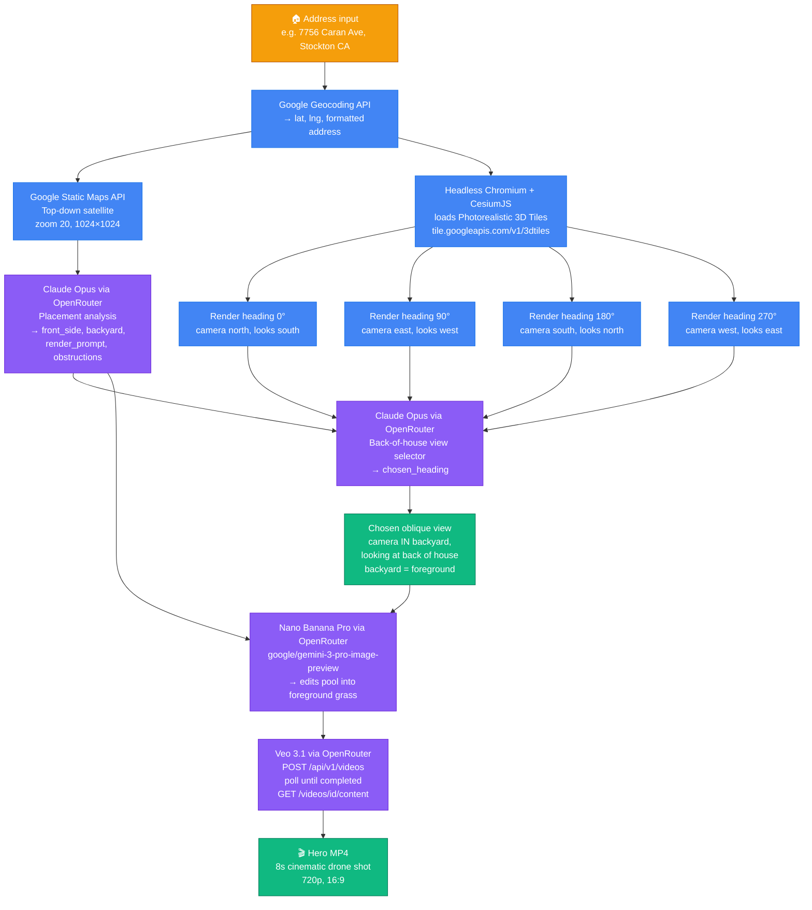

# Pool Visualizer

A system for turning a US street address into a cinematic "here's your dream pool" video, using real satellite/3D imagery of the actual house. Generalizes to any backyard feature (deck, patio, ADU, turf, pickleball court) by swapping prompts.

## What the system does

Input: a street address.
Output: (1) a 3D oblique aerial view of the house, (2) an AI-edited version with a photorealistic pool in the backyard, (3) an 8-second cinematic Veo video.

## Required services & credentials

1. **Google Cloud Platform key** with these APIs enabled on the project:
   - Geocoding API (address → lat/lng)
   - Maps Static API (top-down satellite tile for placement analysis)
   - **Map Tiles API — Photorealistic 3D Tiles** (required for the oblique 3D renders)
   - Billing must be enabled
2. **OpenRouter key** — used for three models:
   - `anthropic/claude-opus-4` (or any capable vision LLM) for placement analysis + back-of-house view selection
   - `google/gemini-3-pro-image-preview` ("Nano Banana Pro") for the image edit
   - `google/veo-3.1` for the final video
3. **Local tooling**: Node 20+, Playwright + Chromium, ffmpeg optional (only if falling back to the Aerial View path).

## Pipeline (the version that actually works)



**Color key:** 🟠 input · 🔵 Google APIs · 🟣 OpenRouter-routed models · 🟢 final output

## Core architectural decisions (and why)

### Why render 4 cardinal views and have Claude pick one
Claude's heading estimates from top-down satellites are unreliable on non-grid neighborhoods. Rendering all four cardinal obliques and letting a vision pass pick the one showing the back of the house eliminates the "camera is looking at the side of the house" failure mode entirely. ~4× slower on the render step, worth it.

### Why the camera sits IN the backyard (not outside it)
In CesiumJS `Camera.lookAt(target, HeadingPitchRange(h, p, r))`, the `heading` offsets the camera at that compass direction *from* the target. So `heading=180` puts the camera SOUTH of the target, looking back north. To see the back of a house whose backyard is south, you want camera in the backyard → heading = direction-from-house-to-backyard = 180.

This framing has a huge second benefit: when the camera sits in the backyard looking at the back of the house, **the backyard is the FOREGROUND of the image** and the front yard/road is the BACKGROUND (often hidden by the house itself). This makes the edit prompt unambiguous:
> Place the pool in the foreground grass area; the road/driveway is behind the house in the background.

Most "pool ended up in the front yard" errors came from the opposite framing (camera outside looking toward the backyard with road in foreground).

### Why Photorealistic 3D Tiles, not Aerial View API
Aerial View API gives a pre-baked cinematic MP4 but only covers a narrow set of US metros, first renders can take 10+ minutes, and many specific addresses return `Address not supported`. Photorealistic 3D Tiles has broader coverage and renders in ~20s, at the cost of needing a Cesium/Three.js renderer and a headless browser.

### Why use Nano Banana Pro for the image and Veo for the video (not Veo alone)
Veo's image-to-video mode uses the supplied image as the first frame, then hallucinates the rest. If we ask Veo to "add a pool" from a raw satellite/3D shot, it drifts — the pool morphs, the house restyles. By using Nano Banana to bake the pool into a still first, Veo's job becomes "animate this scene with minimal changes," which keeps the house faithful.

## Key gotchas discovered during development

1. **OpenRouter video download needs auth.** `unsigned_urls[0]` in the video generation response is a direct upstream URL that returns 401. Use `GET /api/v1/videos/{id}/content` with your OpenRouter bearer token instead.

2. **Claude ignores `response_format: json_object` sometimes.** Always run the response through a tolerant JSON extractor that finds the first `{...}` block in the text.

3. **Cesium `lookAt` heading is camera-position offset, not view direction.** `heading=0` means camera is NORTH of target (looking south at it). Test with a known orientation before trusting it.

4. **The `npx playwright install chromium` command breaks on some Windows shells.** Use `node node_modules/playwright/cli.js install chromium` directly.

5. **For tight property crops, use pitch ≈ -50° and range ≈ 130m.** Steeper pitch or shorter range makes the backyard disappear behind the house. Flatter pitch or longer range brings neighbor houses into the frame and confuses the image model about which house is the target.

6. **Photorealistic 3D Tiles sometimes loads tiles progressively.** Wait for `tileset.tilesLoaded` to stay true across ~30 animation frames before screenshotting, plus a hard timeout.

7. **Rotate any API keys shared in chat logs or commits.** Both Google and OpenRouter keys should be in a `.env` (gitignored), never hardcoded.

## Prompt templates (copy these verbatim)

### Placement analysis (top-down satellite, vision LLM)
```
You are a landscape architect. This is a top-down satellite image of a residential property. North is up.

CRITICAL: The FRONT of the house is the side that faces the road/street and contains the driveway. The BACKYARD is the OPPOSITE side — typically enclosed, often with grass, away from the street. Never confuse them.

1. Identify which compass side of the house is the FRONT (street/driveway side).
2. Identify the BACKYARD (opposite side from the front).
3. Identify obstructions in the backyard (trees, sheds, AC units, slopes, patios, existing structures).
4. Recommend the ideal location, shape, and approximate size for an inground swimming pool — STRICTLY IN THE BACKYARD.
5. Describe the pool position relative to the house using clear directional language.
6. Determine the compass direction FROM the center of the house TOWARD the backyard (0–360°, 0=N, 90=E, 180=S, 270=W).

Respond in JSON: { "front_side": "...", "backyard": "...", "obstructions": "...", "pool_recommendation": "...", "render_prompt": "...", "backyard_camera_heading": <number> }
```

### Back-of-house view selector (takes 4 cardinal renders + top-down satellite)
```
I have 4 oblique 3D aerial views of the same target house (the one closest to the center of each frame), captured at compass headings 0° (camera north), 90° (camera east), 180° (camera south), and 270° (camera west). The camera looks BACK at the target in each view — so heading 180 shows the north side of the house, heading 0 shows the south side, etc.

Backyard description (from satellite): {analysis.backyard}.
Front (street) description: {analysis.front_side}.

Pick which of the 4 views best shows the BACK of the target house — the view where the backyard/back wall of the house is in the foreground, and the front door/driveway/street are hidden behind or beside the house.

Respond in JSON only: { "chosen_heading": <0|90|180|270>, "reason": "..." }
```

### Nano Banana Pro edit (chosen 3D oblique view as input)
```
Add a realistic inground swimming pool to the backyard of the TARGET HOUSE in this oblique aerial photo.

HOW TO IDENTIFY THE CORRECT SPOT:
- The target house is the one closest to the center of the frame.
- This photo was taken from a drone hovering OVER THE BACKYARD, looking across the backyard toward the house. Therefore:
  - The BACKYARD is the grass/lawn area in the FOREGROUND of the image (between the bottom edge of the photo and the target house).
  - The FRONT of the house (driveway, street, road) is BEHIND the house, in the BACKGROUND of the image — often partially hidden by the house itself.
- Place the pool ONLY in the foreground grass/lawn area that belongs to the target house. NEVER between the house and any road/driveway visible in the background. NEVER on a neighbor's lot.

{render_prompt from analysis}

Keep the rest of the image pixel-identical — same house, roof, windows, trees, driveway, neighbors, fences, camera angle, lighting, and shadows. The pool should be photorealistic: blue water, light stone coping, optional surrounding patio and a few lounge chairs. Match the existing perspective and lighting direction. Do not change framing, zoom, or camera angle.
```

### Veo 3.1 video (pool image as input_reference)
```
Cinematic real-estate drone shot of the EXACT property shown in the reference image. The house architecture, roof, walls, windows, trees, driveway, fences, neighbors, and pool shape/position MUST remain faithful to the input image — do not invent a different house, do not restyle, do not move the pool.

Camera move: starts as a high-angle drone shot matching the reference image (~55° looking down). Smoothly pushes in and gently descends toward the backyard, ending closer to the pool with the back of the house as the backdrop behind the pool. Single continuous shot — no cuts, no orbit around the house, no whip pans. The pool stays in the backyard for the entire shot.

Atmosphere: warm golden-hour lighting, sparkling blue pool water with gentle ripples and light caustics, subtle breeze in the trees. High-end real-estate listing style. {render_prompt}.
```

## Minimal reference code

### Cesium 3D render page (serve as static HTML, screenshot via Playwright)
```html
<script src="https://cesium.com/downloads/cesiumjs/releases/1.123/Build/Cesium/Cesium.js"></script>
<link href="https://cesium.com/downloads/cesiumjs/releases/1.123/Build/Cesium/Widgets/widgets.css" rel="stylesheet">
<div id="c" style="width:100vw;height:100vh"></div>
<script>
(async () => {
  const p = new URLSearchParams(location.search);
  Cesium.Ion.defaultAccessToken = '';
  const viewer = new Cesium.Viewer('c', { /* disable all UI chrome */ });
  viewer.scene.globe.show = false;
  const tileset = await Cesium.Cesium3DTileset.fromUrl(
    `https://tile.googleapis.com/v1/3dtiles/root.json?key=${p.get('key')}`
  );
  viewer.scene.primitives.add(tileset);
  const center = Cesium.Cartesian3.fromDegrees(+p.get('lng'), +p.get('lat'), 0);
  viewer.camera.lookAt(center, new Cesium.HeadingPitchRange(
    Cesium.Math.toRadians(+p.get('heading')),
    Cesium.Math.toRadians(+p.get('pitch')),
    +p.get('range')
  ));
  viewer.camera.lookAtTransform(Cesium.Matrix4.IDENTITY);
  // wait for tiles to stop streaming
  let stable = 0;
  await new Promise(resolve => {
    (function tick() {
      stable = tileset.tilesLoaded ? stable + 1 : 0;
      if (stable > 30) return resolve();
      requestAnimationFrame(tick);
    })();
    setTimeout(resolve, 25000);
  });
  window.__ready = true;
})();
</script>
```

### Server helpers (key fragments)

```js
// OpenRouter video: use the authenticated /content endpoint
const startRes = await fetch('https://openrouter.ai/api/v1/videos', {
  method: 'POST', headers: orHeaders,
  body: JSON.stringify({
    model: 'google/veo-3.1',
    prompt,
    input_references: [{ type: 'image_url', image_url: { url: `data:image/png;base64,${imageB64}` } }],
    aspect_ratio: '16:9', duration: 8, resolution: '720p',
  }),
});
// poll GET /api/v1/videos/{id} until status === 'completed'
// then GET /api/v1/videos/{id}/content WITH the auth header to download bytes

// Nano Banana Pro image edit via OpenRouter chat/completions with modalities
await openrouterChat('google/gemini-3-pro-image-preview', [{
  role: 'user',
  content: [
    { type: 'text', text: prompt },
    { type: 'image_url', image_url: { url: `data:image/jpeg;base64,${frameB64}` } },
  ],
}], { modalities: ['image', 'text'] });
// returned image is at data.choices[0].message.images[0].image_url.url (data URL)

// Tolerant JSON extractor for Claude responses
function extractJson(text) {
  try { return JSON.parse(text); } catch {}
  const m = text.match(/\{[\s\S]*\}/);
  if (!m) throw new Error(`No JSON in: ${text.slice(0, 300)}`);
  return JSON.parse(m[0]);
}
```

## Cost per generation (rough, April 2026)

- Geocoding + 1 Static Map tile: ~$0.01
- Photorealistic 3D Tiles session: ~$0.10 (4 renders)
- Claude Opus vision (2 calls, ~5 images): ~$0.05
- Nano Banana Pro image edit: ~$0.04
- Veo 3.1, 8 seconds 720p: ~$3.20 (most of the cost)

Total: ~$3.40 per address.

## Adapting to other use cases

The same pipeline works for any "show me what X would look like on this real property" idea:

- **Decks / patios / outdoor kitchens** — swap pool prompts for deck prompts.
- **ADUs / garden studios** — ensure the footprint fits zoning (you can feed rough setback rules into Claude's analysis step).
- **Turf / landscaping refreshes** — Nano Banana can also remove features, not just add them.
- **Solar panels** — use a steeper pitch (-70°) so roof is fully visible.
- **Pickleball / sport courts** — same pipeline, adjust typical dimensions in the prompt.

Keep the architecture identical; only the prompts and pitch/range defaults change.
